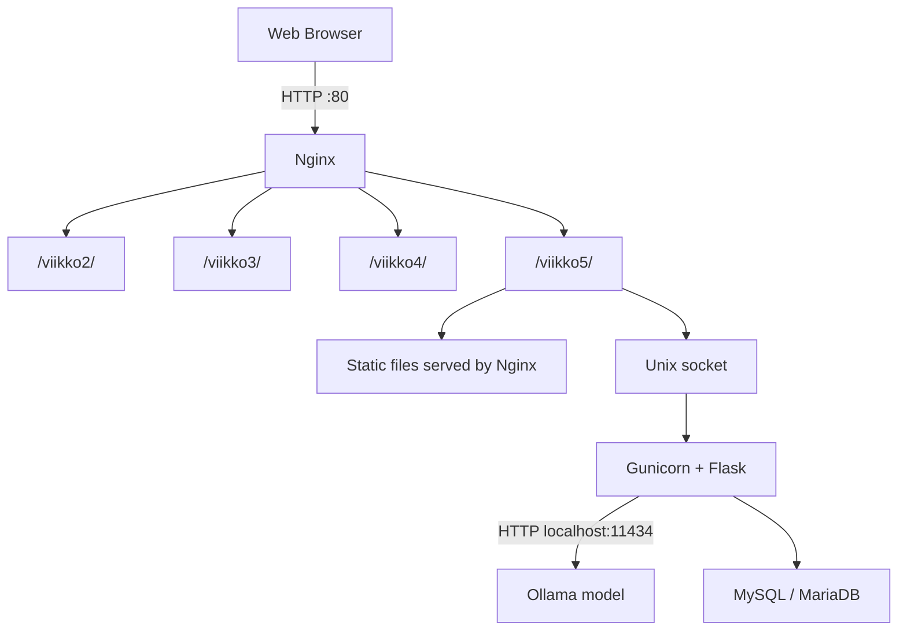

# Chatapp

A chat application built with Flask. It streams responses from an
[Ollama](https://ollama.com/) language model and stores chat history in MySQL or
MariaDB. Nginx serves the application under `/viikko5/`, and Gunicorn runs the Flask
app behind a Unix socket managed by systemd.

## Architecture



The other week-specific sites are shown because this app is designed to share an
existing Nginx server with them; the Week 5 setup and deploy scripts are intended
to leave those sites alone.

## Requirements

### Local development

- Python 3.12 or newer
- Ollama running locally with a model downloaded, to try chat responses

Without database environment variables, the app uses an in-memory history store.
This is suitable for local development and tests; history is lost when the process
restarts. On the server, MySQL or MariaDB is used.

### Server deployment

- An Ubuntu server with `systemd`, `apt`, and `sudo` 
- A public IP and inbound HTTP port 80 allowed by the server's firewall/security
  group
- An existing Nginx site configuration that serves the other course pages
- A deployment account with SSH access and passwordless `sudo` for the setup and
  deploy scripts
- Enough memory and disk for the selected Ollama model. The setup script warns
  when it detects less than 3.5 GB RAM; choose a small model such as
  `qwen2.5:0.5b` on a low-memory VM.

Deploy to the writable MySQL/MariaDB server, not a read-only replica.
The setup script detects and refuses a database server in read-only mode.

## Run locally

From the repository root, enter the application directory and create a virtual
environment:

```bash
cd viikko5
python3 -m venv .venv
source .venv/bin/activate
pip install -r requirements.txt
```

Start Ollama and make a model available, for example:

```bash
ollama pull qwen2.5:0.5b
ollama serve
```

In another terminal, activate the virtual environment and run Flask:

```bash
cd viikko5
source .venv/bin/activate
OLLAMA_MODEL=qwen2.5:0.5b flask --app app run
```

Open <http://127.0.0.1:5000/>. The model must already be available to Ollama.
Set `OLLAMA_URL` if Ollama is not listening at its default
`http://127.0.0.1:11434`.

### Configuration

The application reads configuration from environment variables. Database
configuration is optional locally; setting `DB_NAME` switches the database layer
to MySQL/MariaDB, in which case `DB_USER` and `DB_PASSWORD` must also be set.

| Variable | Default | Description |
| --- | --- | --- |
| `OLLAMA_URL` | `http://127.0.0.1:11434` | Ollama server URL |
| `OLLAMA_MODEL` | `llama3.1:8b` | Model name already pulled by Ollama |
| `SYSTEM_PROMPT` | Finnish assistant prompt | System message sent to the model |
| `HISTORY_LIMIT` | `10` | Previous messages included as model context |
| `DB_NAME` | unset | Database name; when unset, use in-memory history |
| `DB_HOST` | `127.0.0.1` | MySQL/MariaDB host |
| `DB_PORT` | `3306` | MySQL/MariaDB port |
| `DB_USER` | required when using MySQL | Database username |
| `DB_PASSWORD` | required when using MySQL | Database password |

Do not commit passwords or other secrets. The server setup script writes its
database settings to `/etc/chatapp/chatapp.env` with restricted permissions.

## Tests and checks

Run these from the repository root:

```bash
python3 -m pip install -r viikko5/requirements-dev.txt
pytest viikko5
ruff check viikko5
bash -n viikko5/scripts/*.sh
```

The tests use Flask's test client and stub Ollama requests; they do not require a
running Ollama instance or MySQL server.

## Deploy

The deployment consists of a one-time server setup followed by either a manual
deployment or GitHub Actions deployments. The scripts install and update only
the Chatapp-specific files and services.

### 1. Prepare and configure the server

SSH to the existing Ubuntu server as the account that will be used for deployment.
Copy or clone the repository to the server, then run the setup script from the
repository root. Choose a model that fits the VM:

```bash
bash viikko5/scripts/server-setup.sh qwen2.5:0.5b
```

The model argument is optional; the default is `llama3.1:8b`. The script installs
missing packages, enables MySQL/MariaDB and Ollama, creates the `chatapp` system
user and database, and writes the generated database credentials to
`/etc/chatapp/chatapp.env`. If the environment file already exists, its database
password is preserved and only the selected Ollama model is updated.

The script prints the next steps and the Nginx site files it found. Add this
include line **once**, inside the existing site's `server { ... }` block (usually
`/etc/nginx/sites-available/default`):

```nginx
include snippets/chatapp.conf;
```

Then validate and reload Nginx:

```bash
sudo nginx -t
sudo systemctl reload nginx
```

The actual Chatapp Nginx snippet is installed during deployment. Its location
serves the app at `/viikko5/` and static files directly from Nginx. Keep the
existing server block and other weeks' locations intact.

### 2. Deploy manually

From the repository root on your development machine, copy the contents of
`viikko5/` into the server's app directory, then run the deploy script. Replace
`DEPLOY_USER` and `SERVER` with your SSH account and server address:

```bash
rsync -az viikko5/ DEPLOY_USER@SERVER:/opt/chatapp/app/
ssh DEPLOY_USER@SERVER \
  'bash /opt/chatapp/app/scripts/deploy.sh manual'
```

The deploy script installs Python dependencies into `/opt/chatapp/venv`, applies
the database schema, installs and validates the Nginx snippet, installs the
systemd service, restarts Chatapp, and checks its health through the Unix socket.
The first deployment requires the one-time Nginx include described above.

### 3. Enable automatic deployment with GitHub Actions

The workflow at `.github/workflows/ci-cd.yml` runs lint, pytest, and shell syntax
checks on pushes and pull requests. A successful push to `main` deploys
automatically; pull requests run checks only. The workflow can also be started
manually with GitHub Actions' **Run workflow** control on `main`.

In the repository's GitHub Actions secrets (the `production` environment), add:

| Secret | Value |
| --- | --- |
| `CPOUTA_HOST` | Server IP address or hostname |
| `CPOUTA_USER` | SSH deployment account (the account used for server setup) |
| `CPOUTA_SSH_KEY` | Private SSH key for that account |
| `CPOUTA_KNOWN_HOSTS` | Optional pinned `known_hosts` entry for the server |

If `CPOUTA_KNOWN_HOSTS` is not set, the workflow uses `ssh-keyscan` to obtain the
host key. For stronger host verification, set the secret to a verified host-key
entry. Keep the private key in GitHub Secrets; never add it to the repository.

After deployment, the workflow checks the public health endpoint, the chat page,
and a static asset. The app should be available at:

```text
http://SERVER/viikko5/
```

The server's floating IP must be reachable over HTTP from the internet for the
public smoke tests and visitors to access the site.

## Operations and troubleshooting

Useful server-side checks:

```bash
sudo systemctl status chatapp
sudo journalctl -u chatapp -n 100 --no-pager
sudo systemctl status nginx mysql ollama
sudo nginx -t
curl -fsS http://127.0.0.1:11434/api/tags
```

Common issues:

- **Nginx include missing:** Add `include snippets/chatapp.conf;` to the existing
  server block, run `sudo nginx -t`, reload Nginx, then rerun the deployment.
- **App does not start:** Check `sudo journalctl -u chatapp -n 100 --no-pager`.
  Confirm `/etc/chatapp/chatapp.env` exists and the configured database and
  Ollama services are running.
- **Model unavailable or responses time out:** Check Ollama with
  `curl -fsS http://127.0.0.1:11434/api/tags`, confirm the configured model has
  been pulled, and consider a smaller model or more server memory.
- **GitHub deployment cannot connect:** Verify the host, user, SSH key, and
  `known_hosts` secret, and confirm the deployment account can run the scripts'
  required `sudo` commands without an interactive password.
- **Nginx config validation fails during deployment:** The deploy script restores
  its previous Chatapp snippet if validation fails. Fix the Nginx configuration
  and rerun deployment.

## Application endpoints

- `/viikko5/` — chat interface
- `/viikko5/documents.html` — project documentation page
- `/viikko5/health` — deployment revision health check

